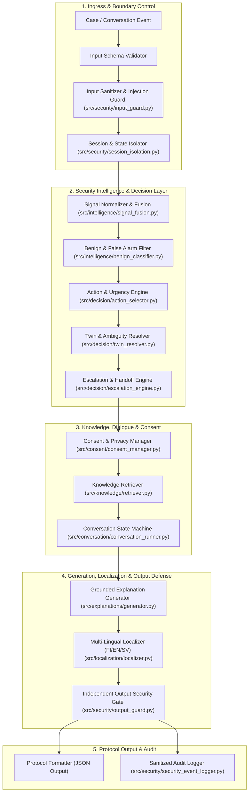

# Component Architecture — DNA Digital Security Assistant

**Document Version:** 1.0.0 (Phase 0 Baseline)  
**System:** DNA Digital Security Assistant (Since AI Hackathon 2026)  
**Architecture Style:** Modular Hybrid (Neuro-Symbolic) Guardian Architecture  

---

## 1. Architectural Philosophy & Principles

To satisfy the non-negotiable hackathon principles, the system separates **deterministic risk decisions and guardrails** from **natural-language generation and explanation**.

1. **Deterministic Core:** Safety decisions, primary action selection, decisive question identification, escalation triggering, and consent gates are governed by deterministic, verifiable rules and state machines.
2. **Explainable AI Generation:** Natural language explanation, empathetic framing, and multi-lingual translation (Finnish, English, Swedish) are grounded strictly on retrieved guidance passages and extracted case evidence.
3. **Defense-in-Depth:** An independent, deterministic output security gate inspects all generated advice before it reaches the user, verifying schema compliance, step presence, and absence of unsafe claims or secrets.

---

## 2. Component Diagram (C4 Level 2 / Container & Components)

---

## 3. Component Directory & Module Responsibilities

The planned component structure aligns with Part IX of the Master Instruction:

### 3.1 `src/security/` (Defense-in-Depth & Boundary Controls)
* **`input_guard.py`:** Sanitizes incoming text, strips dangerous escape sequences, tags user messages and artifact text as untrusted evidence, and detects adversarial prompt injection patterns.
* **`instruction_boundary.py`:** Enforces the instruction hierarchy (system controls > user scope > untrusted artifact content). Blocks meta-instruction overrides.
* **`data_access_policy.py`:** Enforces case data isolation and strict prohibition against exposing system prompts, hidden ground truth, dev cases, or test set answers.
* **`secret_scanner.py`:** Regex and entropy scanner checking generated text for API keys, tokens, environment variables, or protected files.
* **`tool_authorizer.py`:** Validates and restricts any tool/API invocations against an explicit schema allowlist.
* **`output_guard.py`:** Independent verification gate executing `textcheck.find_unsafe()`, checking `step_vocabulary.json` step presence, and verifying readability metrics.
* **`security_event_logger.py`:** Structured, sanitized logging of security events, injection attempts, and consent decisions without logging sensitive credentials.
* **`session_isolation.py`:** Manages server-controlled state tokens and guarantees zero data bleed across conversations.

### 3.2 `src/intelligence/` & `src/decision/`
* **`signal_fusion.py`:** Normalizes inputs across artifacts, link checks, call warnings, subscription events, device findings, and account logins. Accounts for signal availability (`available`, `not_provided`, `not_applicable`).
* **`benign_classifier.py`:** Specifically prevents benign look-alikes (genuine bills, clinic calls, planned maintenance, verified bank changes) from being escalated as security incidents.
* **`action_selector.py`:** Maps multi-signal risk profiles into one of the 10 enumerated actions from `action_vocabulary.json` with calibrated risk and urgency levels.
* **`twin_resolver.py`:** Detects ambiguous "it depends" situations. Determines the exact decisive question topic from `question_topics.json`. In single-turn, adopts the safe fallback action corresponding to the riskier branch.
* **`escalation_engine.py`:** Evaluates escalation triggers (eSIM hijacking, active extortion, severe malware, distress) and formats a structured handoff ticket to the appropriate escalation target.

### 3.3 `src/consent/` & `src/knowledge/`
* **`consent_manager.py`:** Tracks `requires_consent` vs `pre_granted`. Formulates clear consent requests explaining the precise utility before requesting signals. Ensures signals used are strictly necessary.
* **`retriever.py`:** Ingests `guidance_corpus.jsonl` (55 passages) with fast indexed retrieval by topic, journey, and audience. Generates valid citation references.

### 3.4 `src/conversation/` & `src/explanations/`
* **`conversation_runner.py`:** Implements `sim/PROTOCOL.md`, handling `start`, `user_reply`, `consent_reply`, and `turn_limit` events. Enforces single-question policy.
* **`generator.py` & `localizer.py`:** Synthesizes the 3-part response (What is happening, What to do now, Next steps) ensuring the primary action is in the first two sentences, jargon is eliminated, and native phrasing is produced in Finnish, English, and Swedish.
