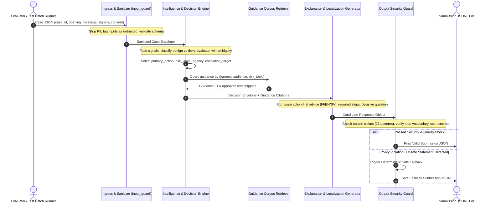

# Data Flow — DNA Digital Security Assistant

**Document Version:** 1.0.0 (Phase 0 Baseline)  
**System:** DNA Digital Security Assistant (Since AI Hackathon 2026)  

---

## 1. Single-Turn Data Flow

In single-turn mode (used for batch development evaluation and the 335 test inputs), the system processes a static case payload into a single JSON response.



---

## 2. Multi-Turn Conversation Protocol Flow (sim/PROTOCOL.md)

In multi-turn mode, the assistant interacts with the simulated user via the event-driven protocol over up to 6 assistant turns.

```mermaid
sequenceDiagram
    autonumber
    participant Harness as Simulator Harness (sim/run_conversation.py)
    participant ConvState as Conversation Controller (src/conversation/)
    participant Decision as Decision & Twin Engine
    participant Consent as Consent Manager

    Harness->>ConvState: Event: "start" (conversation_id, visible_case, max_turns=6)
    Note over ConvState: Initialize isolated session state, inspect signals & consent

    alt Case Requires Decisive User Fact (e.g. Twin)
        ConvState->>Harness: Reply: "question" (text: "Did you enter credentials?", topics: ["credentials_entered"])
        Harness->>ConvState: Event: "user_reply" (text: "En ole syöttänyt mitään.")
        Note over ConvState: Record revealed fact, update case state
    else Case Needs Consent-Gated Signal
        ConvState->>Consent: Check required signals
        Consent->>Harness: Reply: "consent_request" (fields: ["device.recent_app_installs"], text: "May I check installed apps?")
        Harness->>ConvState: Event: "consent_reply" (granted: [...], refused: [...], signals: {...})
        Note over ConvState: Integrate granted signals; adjust strategy if refused
    end

    Note over Decision: Compute final safe decision with updated evidence
    ConvState->>Harness: Reply: "final" (answer: {risk_level, primary_action, advice_text, steps, ...})
```

---

## 3. Data Isolation & Boundary Enforcements

1. **Strict Separation of Development Ground Truth:**
   * Dev cases carry `ground_truth` and `simulation` objects.
   * The runtime engine ingress pipeline strips these fields before passing payloads to the decision engine.
   * Automated tests verify that passing cases without `ground_truth` produces identical decisions to passing raw cases.

2. **Consent State Isolation:**
   * Signals tagged with `requires_consent` are masked with `"available_with_consent"` in multi-turn mode until explicitly granted.
   * The engine maintains a runtime `allowed_signals` set. Any component attempting to read an unconsented signal raises a `ConsentBoundaryViolationException` and falls back to baseline advice without the signal.

3. **Output Defense Gate:**
   * Before returning a response to stdout or writing to `.jsonl`, the candidate JSON is passed through `OutputSecurityGate.verify()`.
   * If any banned claim regex matches or if secret patterns trigger, the entire response is substituted with an audit-logged deterministic refusal/safe advice structure.
