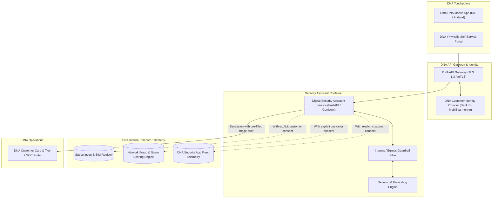

# Deployment Architecture — DNA Digital Security Assistant

**Document Version:** 1.0.0 (Phase 0 Baseline)  
**System:** DNA Digital Security Assistant (Since AI Hackathon 2026)  

---

## 1. Deployment Overview & Execution Modes

The DNA Digital Security Assistant is packaged as a lightweight, modular service supporting three distinct runtime modes:

```mermaid
flowchart LR
    subgraph ExecutionModes[Assistant Execution Modes]
        CLI_Batch["1. Batch Inference CLI<br/>(Single-Turn Prediction Engine)"]
        Bot_Adapter["2. Multi-Turn Bot Adapter<br/>(stdin/stdout & Python Callable)"]
        Demo_UI["3. Interactive Web Demo UI<br/>(DNA Portal Simulation)"]
    end

    subgraph CoreEngine[Shared Security Engine (src/)]
        DecisionEngine["Decision & Intelligence Engine"]
        Guardrails["Output & Boundary Guardrails"]
        KnowledgeBase["Guidance Knowledge Base"]
    end

    CLI_Batch --> CoreEngine
    Bot_Adapter --> CoreEngine
    Demo_UI --> CoreEngine
```

1. **Batch Inference CLI (`src/application/batch_runner.py`):**
   * Processes `data/dev/cases.jsonl` or `data/test/inputs.jsonl` at scale.
   * Outputs compliant `test_predictions.jsonl` matching `schema/submission.schema.json`.
   * Evaluated via `tools/validate.py` and `eval/evaluate.py`.

2. **Multi-Turn Conversation Adapter (`src/conversation/bot_adapter.py`):**
   * Implements `step(event, state) -> reply` conforming to `sim/PROTOCOL.md`.
   * Executable via `sim/run_conversation.py --cases data/dev/cases.jsonl --bot-py src.conversation.bot_adapter:step --out mt_results.jsonl`.

3. **Interactive Demonstration Service (`src/application/demo_ui.py`):**
   * Lightweight local web server (built with Python `http.server` or FastAPI/Flask) rendering a high-fidelity mock of the **Oma DNA App** and **DNA Business Portal**.
   * Provides live interactive testing of the 5 journeys, persona toggling, telemetry visibility, consent approval flows, and 1-click human escalation ticket generation.

---

## 2. Plausible DNA Enterprise Integration Path

In a live production environment, the assistant would be deployed into DNA's cloud environment (e.g. AWS Europe or private OpenShift/Kubernetes cluster in Finland):



### Security & Privacy Protections in Deployment:
* **Zero PII Storage:** Stateless operation—no customer conversation transcripts or device identifiers stored permanently in the assistant container.
* **Strict Least Privilege:** Microservice communicates with internal telemetry APIs solely through authenticated backend service tokens with read-only access.
* **Network Isolation:** In production, container runs without raw public internet outbound access, fetching only authenticated internal threat feeds and approved guidance.
