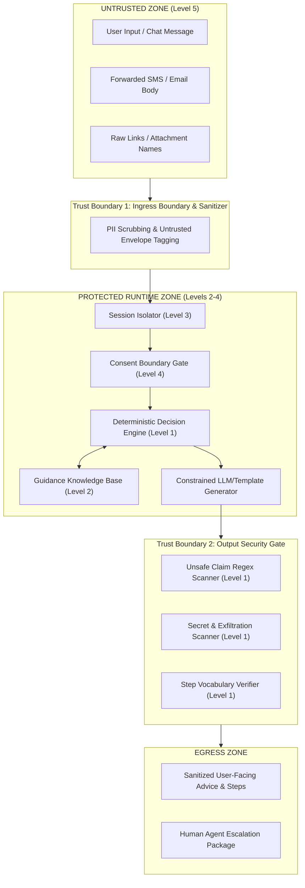

# Trust Boundaries & Data Provenance — DNA Digital Security Assistant

**Document Version:** 1.0.0 (Phase 0 Baseline)  
**System:** DNA Digital Security Assistant (Since AI Hackathon 2026)  

---

## 1. Trust Hierarchy & Model

To maintain robust security guarantees, all information within the system is categorized into strict trust levels:

```
[Level 1: Highest Trust] Server Security Controls, Hardcoded Safety Policies, Schemas
         │
[Level 2: High Trust]    System & Developer System Prompts, Official Vocabularies
         │
[Level 3: Verified]      Authenticated Session Metadata (user_identified=true, case_id)
         │
[Level 4: Internal/Sim]  Simulated Operator Signals (subscription, device, call warnings)
         │
[Level 5: Untrusted]     User Messages, Forwarded Artifacts (SMS/Email/Links), External Text
```

An element at Level N may never alter, override, or diminish the rules or constraints defined at Level < N.

---

## 2. Trust Boundary Architecture



---

## 3. Explicit Boundary Specifications

### Boundary 1: Client to Assistant Ingress
* **Data Crossings:** User chat message, artifact payload, client-supplied metadata.
* **Threats:** Injection of prompt overrides, HTML/script tags, spoofed administrative claims.
* **Controls:** 
  * Strict JSON schema validation (`schema/test_input.schema.json`).
  * Enclosure of all free-text fields in XML/JSON containment tags (`<untrusted_evidence>`).
  * Rejection of any administrative or system commands.

### Boundary 2: Consent Gating Boundary
* **Data Crossings:** Personal and device operator signals (`device.recent_app_installs`, `subscription.network_status`, `operator_account.recent_logins`).
* **Threats:** Unauthorized access to personal context without customer permission.
* **Controls:** 
  * Gated signals are replaced by `"available_with_consent"` until an explicit `consent_reply` grants access.
  * Attempted reads of unconsented fields immediately raise a `ConsentBoundaryViolationException` caught by the runner.

### Boundary 3: Decision Engine to Natural Language Generator
* **Data Crossings:** Selected `primary_action`, `risk_level`, `urgency`, `decisive_question_topic`, and guidance IDs.
* **Threats:** The generation layer modifying the risk rating, reversing the primary action, or adding hallucinated steps.
* **Controls:**
  * The generator receives an immutable decision record.
  * The generator is strictly instructed to explain the decision, never to select it.

### Boundary 4: Generator to Egress (Output Security Gate)
* **Data Crossings:** Generated `advice_text`, `steps`, `questions_asked`.
* **Threats:** Disclosure of system instructions, inclusion of dangerous advice (e.g. telling user to pay scammer), lack of actionable steps.
* **Controls:**
  * Automated regex check against all 23 claims in `data/reference/unsafe_claims.json`.
  * Secret scanning for API tokens or environment variables.
  * Automated regex check against `data/reference/step_vocabulary.json` ensuring required steps are present.
  * Deterministic fallback override upon failure.
